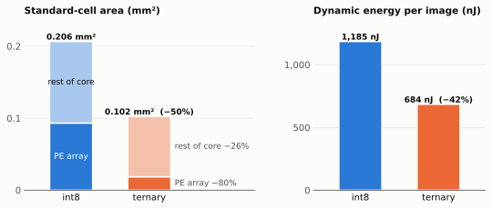
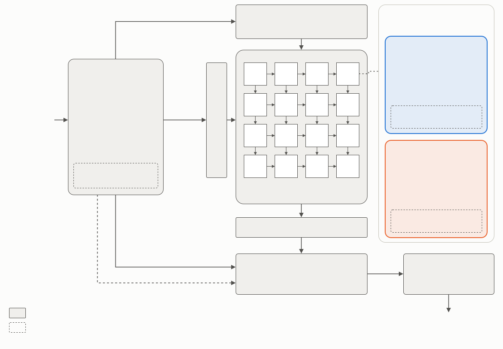
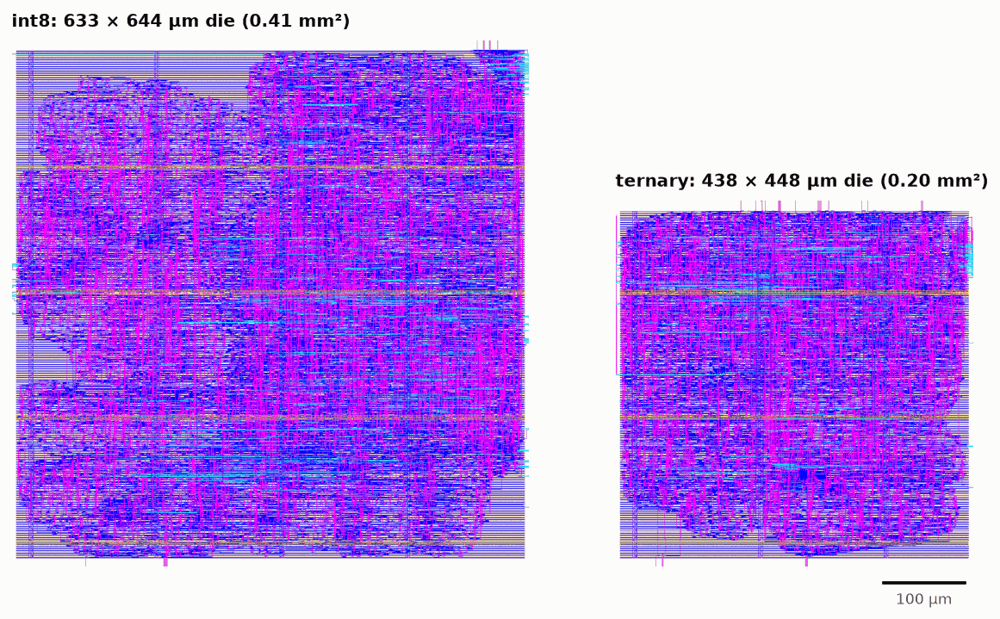
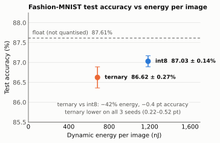
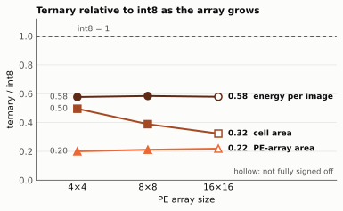
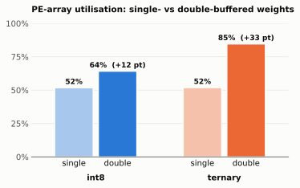
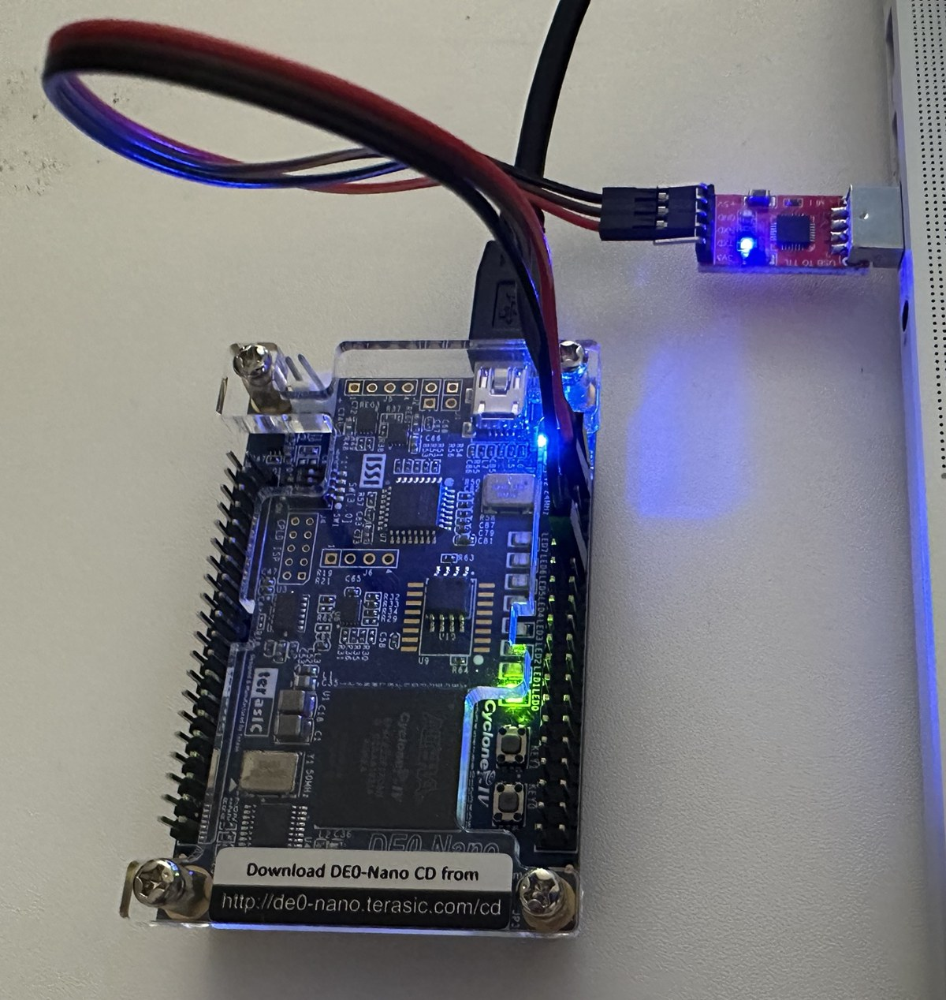
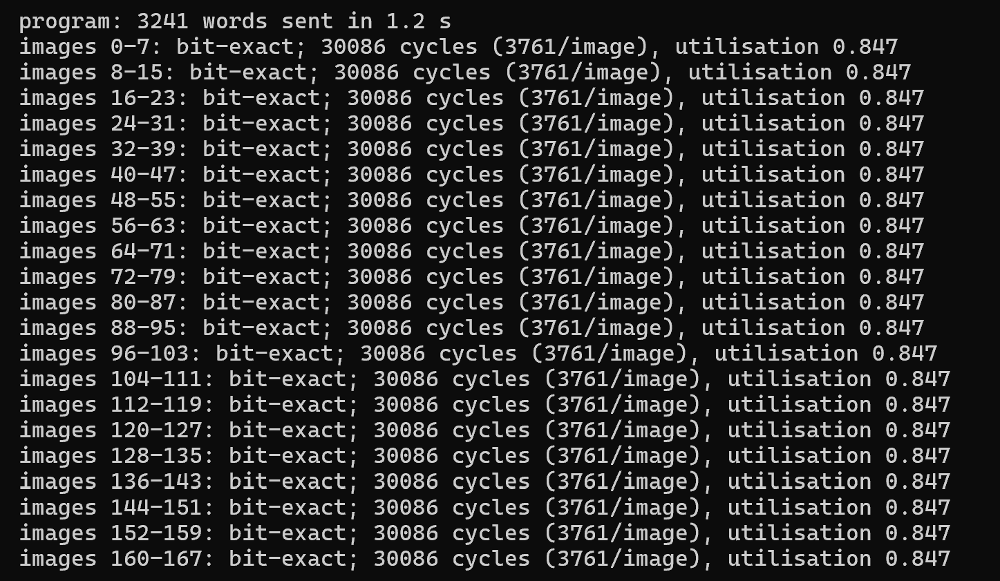

# Ternary vs int8 Systolic Array Accelerator

[](https://github.com/EEmirKK/ternary-accel/actions/workflows/ci.yml)

**Tools:** Verilog, cocotb, Icarus Verilog, LibreLane/OpenROAD, SkyWater 130 nm, Quartus, Python, PyTorch

This project builds the same 4×4 weight-stationary systolic accelerator twice, once with int8 weights and once with ternary weights (−1, 0, +1), whose PEs need no multiplier, and takes both to post-route layout in SkyWater 130 nm. Activations are int8 in both builds (only the weights differ). Ternary uses 50% less cell area and, in gate-level power simulation, 42% less dynamic energy per image, for a 0.4-point drop in Fashion-MNIST accuracy.



*Fig 1. 4×4 array, SkyWater 130 nm (sky130 HD), post-route at a 17.5 ns clock. Cell area excludes fill, decap and tap cells. Energy is dynamic energy from gate-level simulation of the routed netlist on 8 Fashion-MNIST test images, typical corner.*

**At a glance**

- **Physical design:** both builds hardened with LibreLane, with timing closed at 17.5 ns (setup at the typical corner, hold at all corners) and DRC, LVS and antenna clean. Power comes from the switching activity of the routed netlist, not from RTL estimates.
- **Verification:** bit-exact against a NumPy golden model on the first 1,000 images of each test set (MNIST and Fashion-MNIST), on both builds, base and double-buffered. 100% functional coverage, and every mutant caught except two argued to be equivalent (19 injected RTL bugs).
- **FPGA:** both builds run on a DE0-Nano (Cyclone IV E) at 50 MHz. On the board, the first 1,000 images of each test set are bit-exact against the model, and every batch takes exactly the number of cycles the simulation predicts.

## The question

Ternary weights turn every multiplication into an addition, a subtraction or nothing, so a ternary processing element needs no multiplier. In a single PE that saving is easy to see. I wanted to know how much of it survives in a complete accelerator after place-and-route, where the array shares the chip with accumulators, a requantiser, control logic and a clock tree, and what it costs in accuracy.

To keep the comparison fair, I wrote the accelerator once, with a `TERNARY` parameter that selects the PE. Everything else is shared or sized automatically from the weight width, and both builds go through the same LibreLane configuration, floorplan rule and clock constraint. Both networks are trained with the same training setup, number of epochs and seeds.

## What I built



The accelerator is a 4×4 weight-stationary systolic array. Each PE holds one weight. Activations move right through the array and partial sums move down, so each column produces one dot product per activation vector. The host drives the tile loop over a single 32-bit valid/ready stream. For each group of four outputs it sends the biases, then, for each group of four inputs, the weights followed by one activation vector per image in the batch (up to 8). The accelerator accumulates across input tiles in a bank of registers (8 images × 4 outputs, no SRAM), and one shared unit requantises each result to int8 by multiplying by M0, rounding, shifting and clamping, with optional ReLU. The datapath handles full signed int8, but in this network every activation is non-negative. The inputs are pixels shifted right by one bit, and the hidden layer uses ReLU ([`model/mlp.py`](model/mlp.py)).

Ternary changes only the PE. The 8×8 multiplier becomes a select of +a, −a or 0, and because each weight is 2 bits, a whole 4×4 weight tile fits in one 32-bit beat instead of four. In the int8 build, Yosys merges each PE's multiply and partial-sum add into one multiply-accumulate, built from AND-gate partial products, a carry-save adder tree and a final adder, without Booth encoding. Build options add double-buffered weights and read-back cycle counters.

The network is a 784→64→10 MLP, trained with quantisation-aware training for 20 epochs with three seeds per precision, then exported to the exact integers the hardware runs. The ternary quantiser and its 0.7·mean|W| threshold come from [Ternary Weight Networks](https://arxiv.org/abs/1605.04711) (Li et al., 2016). A NumPy model of the same integer arithmetic is the reference every test checks against.



*Both 4×4 layouts after place-and-route in SkyWater 130 nm, at the same scale, routing layers only. The die is sized from the cell area, so it roughly halves as well.*

## How I measured

Both builds go through the same steps with the same settings.

| Step | How | Results |
|---|---|---|
| Training | Quantisation-aware training in PyTorch, 20 epochs, 3 seeds. Accuracy from the bit-exact integer model on the 10,000-image test set, ties counted as errors | `results/accuracy/` |
| RTL simulation | cocotb with Icarus Verilog, every output checked bit-exact against the NumPy model | `results/sim/`, `results/verification/` |
| Physical design | LibreLane (Classic flow), sky130 HD cells, 17.5 ns clock, core sized at 45% utilisation | `results/asic/*_metrics.json` |
| Area | Final layout, standard cells excluding fill, decap, tap and antenna diodes. PE array kept as its own block | `results/asic/*_area.json` |
| Power and energy | Zero-delay gate-level simulation of the routed netlist on 8 Fashion-MNIST images, then OpenROAD power analysis (typical corner, nominal parasitics, clock tree included). Energy per image = average power × time ÷ 8 | `results/asic/*_power.json` |

A build counts as closed only if setup is met at the typical corner, hold at all nine corners, and DRC, LVS and antenna checks are clean. Both 4×4 builds also close at 11.5 ns, and their layouts at 11.5 ns and 17.5 ns are identical, with the same cells, area and energy per image, so the results don't depend on the clock. I used 17.5 ns (57 MHz) as one common clock for the whole size sweep, because every array size meets setup there at the typical corner. The 16×16 runs miss full signoff for other reasons, listed under Limitations.

These results were produced during development, and that history is private. I re-ran the RTL suite, coverage, mutation testing and the end-to-end runs on the published RTL, with identical results. With the method fixed, here is what it showed.

## What I measured

### Where the saving comes from

| 4×4, 17.5 ns, post-route | int8 | ternary | change |
|---|---:|---:|---:|
| Cell area (µm²) | 206,462 | 102,382 | −50% |
| &nbsp;&nbsp;PE array | 93,244 | 18,660 | −80% |
| &nbsp;&nbsp;Rest of core | 113,217 | 83,722 | −26% |
| Dynamic power at 57 MHz (mW) | 11.02 | 6.37 | −42% |
| Dynamic energy per image (nJ) | 1,185 | 684 | −42% |
| &nbsp;&nbsp;PE array | 319 | 102 | −68% |
| &nbsp;&nbsp;Rest of core, clock tree included | 866 | 582 | −33% |
| Dynamic energy per MAC (pJ), 50,816 MACs per image | 23.3 | 13.5 | −42% |

Inside the array, removing the multiplier does what I expected, shrinking the PE array by 80%. At this size, the PE array is less than half of the int8 chip, at 45% of the cell area and 27% of the dynamic energy (18% and 15% for ternary), with the rest going to control, accumulation, requantisation and the clock tree. Its share grows with size, reaching 79% of the int8 cell area at 16×16, which is why the area saving grows with array size (Fig 3). That rest still shrinks by 26%, because ternary products are narrower. Partial sums are 11 bits instead of 18 and accumulators 19 instead of 26, so the deskew registers, the accumulator bank and its adders all get smaller. The accumulator bank alone drops from 832 to 608 flip-flops. The array's energy falls by less than its area (68% vs 80%), consistent with the per-PE registers being clocked every cycle in both builds. Part of the array's energy saving likely comes from sparsity rather than from the missing multiplier. About 54% of the ternary network's first-layer weights are zero, against 4% for int8, and a zero weight feeds a constant zero into its PE's adder. The total lands at 42%.

### Accuracy



*Fig 2. Fashion-MNIST, 10,000 test images, mean ± sample standard deviation over 3 seeds. Energy from gate-level simulation of the seed-0 networks on 8 test images.*

On Fashion-MNIST, ternary loses 0.4 points, 86.62% against 87.03%. It is lower on every seed, by 0.22 to 0.52 points. On MNIST the gap is 0.7 points (96.55% against 97.29%). The float networks reach 87.61% and 97.49%.

The output scale turned out to matter. The hardware maps the largest positive training logit to 127, because the symmetric rule (largest |logit| → 127) left many test images with tied top logits, which count as errors. That rule cost int8 0.6 points on Fashion-MNIST and ternary only 0.1, leaving the two builds level at 86.45% and 86.49%. The positive-only scale is better for both builds and helps int8 more, so it does not flatter ternary. Taking the argmax of the full-width sums instead of the int8 output, the Fashion-MNIST gap would be 0.67 points. These are all 4×4 results. The next question is whether the savings hold as the array grows.

### The area saving grows with array size, but the energy saving doesn't



*Fig 3. Ternary divided by int8 at each size, all post-route in the same flow at 17.5 ns. Energy from gate-level simulation on 8 Fashion-MNIST images. Hollow markers show the 16×16 runs, which are not fully signed off (int8 misses slow-corner hold on input-port paths, and ternary has one antenna violation).*

I repeated both builds at 8×8 and 16×16 with the same flow and clock. The area saving grows with size. Ternary needs 50% of int8's cell area at 4×4, 39% at 8×8 and 32% at 16×16, because the PE array, which ternary shrinks to about a fifth, becomes most of the chip. I expected the energy saving to grow with it. It doesn't. Ternary uses 58% of int8's energy per image at every size.

Area counts hardware, but energy per image counts work. The network needs the same 50,816 multiply-accumulates per image at any array size. A bigger array only finishes them in fewer cycles. The energy in combinational logic, which includes all the arithmetic, therefore stays almost constant for int8 (326, 308 and 339 nJ per image), and that is where ternary saves most. What grows with size is the energy of the flip-flops and the clock tree, which run every cycle because there is no clock gating. For int8 it rises from 859 to 1,401 nJ per image, and ternary cuts it only to about two thirds. A bigger array is faster but not more efficient, as int8's energy per image rises from 1,185 nJ at 4×4 to 1,740 nJ at 16×16.

Size is one way the two builds diverge. The other is how well they keep the array busy.

### Double-buffering helps ternary far more than int8



*Fig 4. Utilisation = activation beats accepted ÷ total cycles, from the on-chip counters in RTL simulation of the two-layer MLP on a batch of 8 Fashion-MNIST images (seed-0 networks, 4×4 array). The area and energy figures above are for the single-buffered builds.*

Without double-buffering, both builds keep the array busy only 52% of the time, for different reasons that happen to cost the same. Before a new weight tile can be written, the old weights have to finish their pass through the array. int8 waits 3 cycles for that and then needs 4 beats to send the tile. Ternary sends the whole tile in one beat but has to wait 6 cycles, because that beat rewrites all four rows at once. Either way, every 8 activation vectors cost about 7 extra cycles.

Double-buffering gives each PE a second weight register, so the next tile loads while the current one is still in use, and the wait disappears. What remains are the weight beats themselves, which share the one input stream with the activations. That caps utilisation at 8 / (8 + 4) = 67% for int8 and 8 / (8 + 1) = 89% for ternary. The measured 64% and 85% sit just below those limits, and the FPGA board's own counters give the same 64% and 85%. Ternary's narrow weights pay off twice, in area and in the input bandwidth they leave for activations. Double-buffering cuts ternary's cycles per image by 39% and int8's by 19%. One more measurement concerns the clock.

### What limits the clock

In every build and at every size, the register-to-register path with the least setup slack at the typical corner ends in the accumulator bank. In one cycle it selects one image's row of accumulators, adds the column sums from the array and writes the result back. Its slack at the nominal typical corner shrinks as the array grows, from 7.5 to 3.9 ns for int8 and from 7.2 to 5.7 ns for ternary, out of a 17.5 ns period. In the 4×4 int8 build the overall worst path also ends in the accumulator bank but starts at an input port, consistent with the bias beats being written into it straight from the input stream. The next speed-up therefore lies in the accumulator update, not in the PEs. None of these numbers would matter if the hardware computed the wrong answers, which is what the next section checks.

## Verification

Every check compares the hardware against the same NumPy model of the integer arithmetic, bit for bit.

| Check | Result | Evidence |
|---|---|---|
| Golden model | The tiled model, which follows the hardware's tiles and widths, matches a plain NumPy x·W + b with the same rounding and clamping. The fast model used for accuracy matches the tiled one, and accumulator overflow is detected. | `tests/test_model.py`, [`suite.txt`](results/verification/suite.txt) |
| cocotb RTL suite | 16 tests, including constrained-random layers with input gaps and output back-pressure, on 6 builds (int8 and ternary × base, counters, double-buffered) and on the base builds at 8×8 and 16×16. All pass, and the counter and double-buffer tests run only where those features exist. | [`suite.txt`](results/verification/suite.txt) |
| Functional coverage | 100% of the coverage bins (64 to 67 per build) in all 10 builds, covering value extremes, padding, batch sizes, stalls, a reset mid-stream, and crosses of these. | [`coverage/`](results/verification/coverage/) |
| Mutation testing | 19 injected RTL bugs, each run against all 6 builds. Every mutant is caught in every build where it changes behaviour, except two that survive in one build where they are argued to be equivalent (see below). | [`mutants.md`](results/verification/mutants.md) |
| End-to-end on the RTL | The first 1,000 images of each test set (MNIST and Fashion-MNIST), on both builds, with every hidden value and logit bit-exact, in both the base and double-buffered configurations. | [`e2e.jsonl`](results/sim/e2e.jsonl), [`e2e_db.jsonl`](results/sim/e2e_db.jsonl) |
| Gate-level | Every post-route netlist (both builds at 4×4, 8×8 and 16×16) runs the MLP on 8 Fashion-MNIST images bit-exact. These are the runs that produce the power numbers. | `results/asic/*_17.5ns_power.json` |
| FPGA wrapper | The complete DE0-Nano design, with its UART link and on-chip RAMs, runs the MLP in simulation on batches of 8 and 3 images, bit-exact. | [`fpga_sim.jsonl`](results/fpga/fpga_sim.jsonl) |
| FPGA board | The first 1,000 images of each test set on the DE0-Nano, both builds, driven over the UART by `fpga/host.py`. All bit-exact, with the same correct counts as the RTL simulation and exactly the cycle counts the wrapper simulation predicts (39,657 for int8 and 30,086 for ternary per batch of 8). | [`board_*.json`](results/fpga/) |

CI runs the model tests, all 6 RTL builds, a short end-to-end run, the counter measurement and the UART check on every push.

The two surviving mutants both weaken the weight-drain wait in the int8 double-buffered build. They are argued to be equivalent, because in that build the wait can never stall anything, as [`mutants.md`](results/verification/mutants.md) explains.

The FPGA runs the double-buffered build with performance counters. On it, the int8 build uses 7,492 logic elements (34%) and the ternary build 4,523 (20%) of the DE0-Nano's Cyclone IV E. Both meet timing at 50 MHz in all three timing models. Ternary needs about a third of the memory bits, because its weights take a quarter of the program memory. It still uses six of the FPGA's 9-bit multipliers, all of them in the shared requantiser. int8 uses 22, one per PE plus the same six.

 

*Left, the DE0-Nano with the USB-UART adapter on its GPIO-0 header, running `fpga/host.py`. Right, the ternary build running on the DE0-Nano. Every batch is bit-exact and takes exactly the 30,086 cycles predicted by simulation.*

## Limitations and next steps

- **Typical-corner signoff.** Setup is signed off at the typical corner only. At the slow corner, the 4×4 builds would need a period of about 20 ns (17.5 ns minus their slow-corner setup slack). int8's tightest closing clock, 11.5 ns, is set by slow-corner hold on a path through an I/O port (0.09 ns of slack, against 0.86 ns on register-to-register paths). That slack improves steadily with the period, consistent with an I/O delay constraint that scales with the clock, but I did not trace those paths.
- **16×16 is not fully signed off.** int8 misses slow-corner hold on input-port paths, and ternary has one antenna violation. Its area and energy are post-route measurements, but the runs would need another pass to close.
- **Energy is simulated, at one operating point and without glitches.** It comes from zero-delay simulation of 8 Fashion-MNIST images at the typical corner, and there is no MNIST energy. Glitches are worst in deep arithmetic such as multipliers, so leaving them out probably understates int8's power more than ternary's, but this wasn't measured.
- **Design-rule warnings remain in both closed builds.** At the slow corner, int8 has 4,827 max-slew, 6 max-capacitance and 52 max-fanout violations, and ternary has 2,502, 22 and 47 (at the typical corner, 184 and 283 max-slew). LibreLane's default signoff reports these without gating on them, and I left them unfixed.
- **The double-buffered builds were not taken through the physical flow**, so the area and energy cost of the second weight register is not measured.
- **No clock gating.** Flip-flops and the clock tree dominate the energy, and their share grows with array size, so clock gating is the most promising next step for both builds.
- **The accumulator bank is the slowest internal path.** Every build's worst register-to-register path ends there, so pipelining its read-add-write update is the next step for speed.
- **Scope and utilisation.** One small MLP, no convolution layers, and accumulators held in registers, which does not scale to large batches. The 52% to 85% utilisation needs batches of 8. With one image it is 12% single-buffered and 20% (int8) or 24% (ternary) double-buffered. int8 is also capped by the shared input stream, and a wider weight port would lift that cap.
- **The 8-bit output costs accuracy.** On Fashion-MNIST it costs int8 0.7 points and ternary 0.4 against a full-width argmax, and a wider output would recover some of that.

The commands below cover the main steps, and each script's header describes its other outputs.

## Use of AI

I designed the architecture, made the decision at each design trade-off and did the performance analysis. I used Claude Code to help implement the code and RTL and to review my work, and I only accepted changes I had checked and could explain.

## How to run

You need Python 3.12 and Icarus Verilog 12. Training needs PyTorch and the figures need matplotlib (both in `requirements-train.txt`), the physical flow needs LibreLane (run through nix-shell) and the sky130 PDK, and the FPGA build needs Quartus Prime Lite.

```bash
pip install -r requirements.txt
pytest tests/ tb/test_runner.py                  # golden-model tests and the cocotb suite (6 builds)
pytest tb/test_e2e_runner.py                     # the MLP on the RTL, 8 images per build and dataset
tb/run_e2e.sh 1000 base                          # 1,000 images per build and dataset -> results/sim/e2e.jsonl

pip install -r requirements-train.txt
train/run_all.sh && python train/summarize.py   # training: 2 datasets x 3 precisions x 3 seeds
python scripts/make_figures.py                   # figures/ from results/

# physical flow: LibreLane runs through nix-shell in $LIBRELANE_DIR (default ~/librelane), PDK_ROOT defaults to ~/.ciel
flow/harden.sh ternary 17.5 && flow/measure.sh ternary 17.5
python flow/check_closure.py ternary 17.5 && python flow/asic_summary.py

# FPGA (Quartus on Windows, called from WSL)
QUARTUS_BIN=/mnt/c/.../quartus/bin64 QUARTUS_WORK=/mnt/c/.../quartus-work fpga/quartus/build.sh ternary
python fpga/host.py --port COM5 --precision ternary --dataset fashion --images 1000   # Windows Python in PowerShell, as WSL2 can't open COM ports
```

| Folder | Contents |
|---|---|
| `rtl/` | Accelerator RTL |
| `tb/`, `tests/` | cocotb testbench, runners and mutation testing, plus golden-model tests |
| `model/` | NumPy golden model of the integer arithmetic |
| `train/` | Quantisation-aware training and export to integers |
| `flow/` | LibreLane configurations and the area, power and timing scripts |
| `fpga/` | DE0-Nano wrapper, Quartus project and host script |
| `results/` | Every measured number in this README |
| `scripts/`, `figures/`, `docs/` | Figure script, figures and the architecture diagram |

## License

MIT
